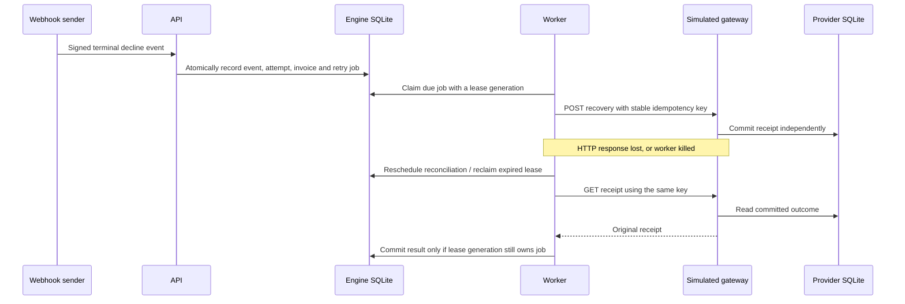

# Payment Decline Recovery

A Go service that keeps webhook redeliveries separate from payment attempts. It schedules bounded retries for a soft decline, reconciles unknown results with a separate HTTP provider, journals conflicting events, and recovers abandoned worker leases.

This is a **new portfolio implementation created in November 2026**, using synthetic invoices and a durable simulated gateway. It demonstrates the engineering problem described in my CV; it is not the original source or evidence of historical production traffic. No card data, payment credentials, real charges, or provider SDKs are used.

## Run the reproducible demo

Requires Go 1.26 or newer. Dependencies are recorded in `go.mod` and `go.sum`.

```sh
go run ./cmd/recovery demo
```

The demo starts a real loopback HTTP provider with its own temporary SQLite file and uses a fixed logical engine clock. It delivers the same webhook ten times, delivers a second event ID for the same failed attempt, and drops the HTTP connection after the provider commits a recovery. The next worker step looks up the committed receipt and completes the invoice.

Expected final counters:

| Counter | Result |
| --- | ---: |
| Webhook deliveries submitted | 11 |
| Distinct webhook events | 2 |
| Payment attempts, including the original decline | 2 |
| Retry jobs | 1 |
| Simulated provider effects | 1 |
| Pending jobs | 0 |

The invoice ends in `paid`; the command fails if the final invariants do not hold. The JSON output includes engine snapshots and independent provider-effect counts before and after reconciliation. A separate integration test also forcibly kills a worker process in this crash window.

## Why three identities matter

| Identity | Purpose | Uniqueness boundary |
| --- | --- | --- |
| `event_id` | One provider notification, possibly delivered repeatedly | `events.id` |
| `attempt_id` | One business payment attempt, possibly described by multiple notifications | `attempts.id` |
| Retry job ID | One intended recovery attempt, possibly executed by several workers after failures | `jobs.source_attempt`; provider idempotency key |

Deduplicating only event IDs fails when a provider emits two event IDs for the same decline. Creating a new provider key on every worker retry fails when the provider committed the first request but its response was lost.



The API, worker and provider run as separate commands. The provider stores receipts in `provider.db`; the engine uses `recovery.db`. Preserve both files across restarts. The fast unit-test fake is only compiled into tests.

## Behavior and boundaries

- Only `insufficient_funds` is retryable in this demonstration policy. `lost_card` and `do_not_honor` stop for manual review. These mappings are examples, not a universal card-network policy.
- At most three recovery attempts follow the initial decline, delayed by 1, 2 and 4 minutes from the previous outcome.
- Transport failures are not declines. Unknown results move the **same** job/key into `reconcile` mode. The engine calls `Lookup` before considering another recovery request.
- Each job has a persisted 15-minute resolution deadline starting at its first claim. Unknown/unresolved work reaches `needs_review` at the deadline and cannot be claimed again. The worker must be running to perform this transition; it is not an independent timer.
- Transport backoff doubles up to 256 seconds. A simulator `429` is a guaranteed pre-acceptance rejection; the engine honors `Retry-After` within the resolution window. Other 4xx responses pause for review. Network errors, malformed responses and 5xx responses are treated as unknown.
- A single atomic `UPDATE … RETURNING` claims each job. Leases last 30 seconds. Their generation prevents an expired worker from committing or releasing a newer worker's claim.
- SQLite WAL and `BEGIN IMMEDIATE` serialize mutations across independent processes on the same host. This is not a distributed database or a multi-host deployment design.
- An attempt has one immutable terminal outcome. A contradictory event or unknown attempt for an existing invoice is durably journaled as `needs_review`, with HTTP `202`. Active jobs for the referenced invoice are paused, and stale workers are fenced from committing. An already dispatched external request cannot be recalled by a database transaction.
- A duplicate old decline cannot reopen a paid invoice.
- Repeated provider requests are possible. One logical provider effect is guaranteed here by the **simulated provider's durable idempotency contract**, not by a claim of exactly-once network delivery. A real adapter must supply equivalent idempotency retention and lookup semantics.
- The API and provider wait for active HTTP handlers during shutdown, up to five seconds. At that deadline connections are closed and the command returns an error. A cancelled worker leaves recoverable leased work for the next process.

## Reconciliation contract

| Observation | Engine action |
| --- | --- |
| Provider confirms success or decline | Record the immutable outcome; schedule another business attempt only for a retryable decline within the three-retry budget |
| Response lost / server error / abandoned lease | Look up the same key; do not assume the payment failed |
| Lookup returns the committed receipt | Finish locally without another POST |
| Lookup authoritatively returns 404 | Recheck the lease and resolution deadline; submit the same key again |
| Lookup unavailable | Keep reconciling with backoff, then pause for review at the deadline |
| Invalid terminal receipt / rejected request | Pause for review |

The simulator's lookup is authoritative and receipts do not expire. A real provider with eventual consistency or expiring idempotency keys requires a different adapter policy. Pointing the worker at a new or wiped provider database does not preserve the guarantee.

Use `recovery reviews` and `recovery inbox` to inspect paused jobs and conflicting payloads. These commands are read-only. There is no automatic approval, resume, or terminal-outcome override; see [the review and migration runbook](docs/operations.md).

## Run API and independent workers

Build once, then start the synthetic provider in the first terminal:

```sh
go build -o bin/recovery ./cmd/recovery
./bin/recovery provider -db provider.db -fault drop_after_commit
```

In a second terminal, start the API:

```sh
export RECOVERY_WEBHOOK_SECRET='disposable-local-demo-secret'
./bin/recovery serve -db recovery.db
```

In a third terminal, start a worker:

```sh
./bin/recovery worker -db recovery.db -gateway http://127.0.0.1:8090
```

You may start another worker with the **same engine database path and provider URL** to exercise competing claims. The provider supports `-outcome success|soft|hard` and `-fault none|drop_after_commit|timeout_after_commit|unavailable|rate_limit|reject`. `drop_after_commit` and `timeout_after_commit` apply only to the first committed recovery for each key; subsequent lookups return its receipt. Other fault modes affect POST requests; GET lookup remains available. Use fresh files for unrelated scenarios. Changing `-outcome` does not change an existing receipt.

Send events from another terminal, with the same disposable secret:

```sh
export RECOVERY_WEBHOOK_SECRET='disposable-local-demo-secret'
python3 scripts/send_webhook.py
python3 scripts/send_webhook.py
python3 scripts/send_webhook.py --event-id delivery-2
./bin/recovery snapshot -db recovery.db
./bin/recovery inbox -db recovery.db
./bin/recovery reviews -db recovery.db
```

The first job becomes due after one minute. The `demo` command avoids waiting by advancing its logical clock.

## HTTP contract

`POST /webhooks` accepts exactly one JSON object:

```json
{
  "event_id": "delivery-1",
  "invoice_id": "synthetic-invoice",
  "attempt_id": "initial-attempt",
  "status": "failed",
  "code": "insufficient_funds"
}
```

A successful initial payment uses `"status":"succeeded"` with no decline code. IDs are 1–96 ASCII letters, digits, underscores or hyphens. Unknown fields, unsupported outcomes and oversized bodies are rejected.

Headers:

- `X-Webhook-Timestamp`: Unix seconds, within five minutes of server time.
- `X-Webhook-Signature`: hex HMAC-SHA256 over `timestamp + "." + raw_body`, using `RECOVERY_WEBHOOK_SECRET` (at least 16 bytes).

The sender signs each redelivery with a current timestamp. Signature and payload validation occur before journaling. Normal delivery returns `200` with `status`, `duplicate_delivery` and an optional `reason`. A different event ID for an already recorded attempt has `status:"duplicate"` and `duplicate_delivery:false`, without another retry. An authenticated, valid conflicting event is persisted and acknowledged with `202`, `status:"needs_review"` and a reason. Other responses: `400` invalid payload, `401` invalid signature/time, `413` oversized body, `503` storage failure.

`GET /health` checks database connectivity. `GET /snapshot` returns consistent counters and synthetic invoice states. `GET /inbox` returns the latest 100 canonical payload variants with decisions and delivery counts; `GET /reviews` returns up to 100 paused jobs. These read endpoints have no authentication. The API binds to `127.0.0.1:8080`, and the simulator to `127.0.0.1:8090`; both are local demonstration services.

Repeated identical payloads increment their inbox delivery count. A changed payload under the same event ID gets a separate `needs_review` record, preserving the original. `payload_hash` is computed from the canonical decoded event, not the raw signed request bytes. Failed authentication or invalid JSON is not persisted.

## Upgrading from the initial version

The first open migrates the engine database atomically to schema version 2. Stop old processes and make a backup first. Accepted events, attempts and old provider receipts are retained. Unfinished legacy jobs with previous deliveries are paused for review because their original provider outcome cannot be inferred safely. Full procedure: [operations and migration](docs/operations.md).

The worker now uses HTTP; `-outcome` belongs to `provider`. Webhook conflicts change from `409` to a durable `202` acknowledgement. The old embedded-provider snapshot counter is named `legacy_provider_receipts`; the current provider exposes its own `/snapshot`.

## Verification

`GET /metrics` provides durable Prometheus counters and queue gauges across all
worker processes. See [metric meanings and scrape configuration](docs/metrics.md).

Run `python3 scripts/benchmark.py` after building for measured webhook latency and
one-versus-four-worker throughput with correctness assertions. See the
[benchmark methodology](docs/benchmark.md) before interpreting the results.

```sh
go vet ./...
go test -race -count=1 -cover ./...
go build -o bin/recovery ./cmd/recovery
./bin/recovery demo
python3 scripts/smoke.py
```

Tests cover deduplication, durable conflict journaling, paused-job fencing, retry timing and budget, unknown-result reconciliation and expiry, migration rollback, signed HTTP requests, real connection loss and deadlines, graceful shutdown, and **four separate worker processes** sharing one database. The HTTP crash test actually kills a worker after the independent provider commits, restarts a new worker, and asserts one POST and one lookup. The smoke script launches the compiled API, provider and worker as three separate processes and checks the complete HTTP flow. GitHub Actions runs these checks.

See [verification results](docs/verification.md) for commands actually run and their limitations.

## Code map

- `internal/recovery/store.go`: transaction boundaries, event deduplication, scheduling and leases.
- `internal/recovery/worker.go`: recovery/reconciliation decisions and bounded manual escalation.
- `internal/recovery/gateway_http.go`: HTTP provider adapter and error classification.
- `internal/recovery/inbox.go`: durable event decisions and review inspection.
- `internal/recovery/migrate.go`: atomic migration from the initial database format.
- `internal/recovery/http.go`: webhook authentication and HTTP boundary.
- `internal/simulator/`: independent HTTP simulator and real-process crash tests.
- `internal/httpserver/`: bounded graceful shutdown and active-request tests.
- `cmd/recovery/`: API, provider, worker, diagnostics and HTTP reconciliation demo.

## Interview walkthrough

1. Run `demo` and compare the three snapshots.
2. Explain why delivery deduplication does not solve attempt deduplication.
3. Locate the provider receipt commit and engine result commit; explain how lookup bridges their crash window.
4. Explain the difference between preventing duplicate effects at a provider and fencing stale database writes.
5. Explain why a confirmed decline, unknown network result and conflicting webhook produce different transitions.
6. Describe the changes needed for a real provider: durable invoice/payment-method references, consent and retry policies, signed provider-specific events, reconciliation guarantees, idempotency retention, operational alerts and production access controls.
