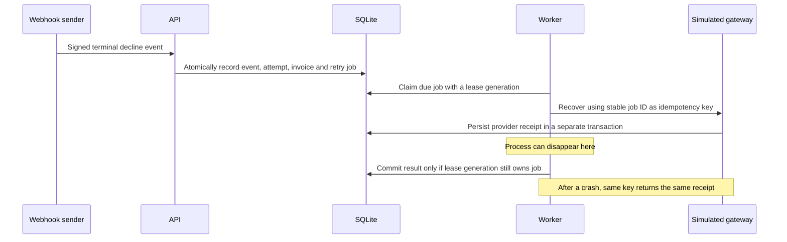

# Payment Decline Recovery

A Go service that keeps webhook redeliveries separate from payment attempts. It schedules bounded retries for a soft decline, recovers abandoned worker leases, and reuses the provider idempotency key when a result is unknown.

This is a **new portfolio implementation created in November 2026**, using synthetic invoices and a durable simulated gateway. It demonstrates the engineering problem described in my CV; it is not the original source or evidence of historical production traffic. No card data, payment credentials, real charges, or provider SDKs are used.

## Run the reproducible demo

Requires Go 1.26 or newer. Dependencies are recorded in `go.mod` and `go.sum`.

```sh
go run ./cmd/recovery demo
```

The demo uses a temporary database and a fixed logical clock. It delivers the same webhook ten times, delivers a second event ID for the same failed attempt, and simulates a crash after the provider has accepted a retry but before the worker stores its result. It then reclaims the expired lease.

Expected final counters:

| Counter | Result |
| --- | ---: |
| Webhook deliveries submitted | 11 |
| Distinct webhook events | 2 |
| Payment attempts, including the original decline | 2 |
| Retry jobs | 1 |
| Simulated provider effects | 1 |
| Pending jobs | 0 |

The invoice ends in `paid`; the command fails if the final invariants do not hold. The JSON output includes snapshots before and after the simulated crash.

## Why three identities matter

| Identity | Purpose | Uniqueness boundary |
| --- | --- | --- |
| `event_id` | One provider notification, possibly delivered repeatedly | `events.id` |
| `attempt_id` | One business payment attempt, possibly described by multiple notifications | `attempts.id` |
| Retry job ID | One intended recovery attempt, possibly executed by several workers after failures | `jobs.source_attempt`; provider idempotency key |

Deduplicating only event IDs fails when a provider emits two event IDs for the same decline. Creating a new provider key on every worker retry fails when the provider committed the first request but its response was lost.



The gateway uses a separate transaction in the same local database to expose the crash window without an external service. Provider receipt persistence and engine result persistence are intentionally not one transaction.

## Behavior and boundaries

- Only `insufficient_funds` is retryable in this demonstration policy. `lost_card` and `do_not_honor` stop for manual review. These mappings are examples, not a universal card-network policy.
- At most three recovery attempts follow the initial decline, delayed by 1, 2 and 4 minutes from the previous outcome.
- Transport failures are not declines. They reschedule the **same** job and key, with a delay capped at 256 seconds. Ambiguous transport failures have no automatic retry-count cutoff; production operations would need an alert and reconciliation process.
- A single atomic `UPDATE … RETURNING` claims each job. Leases last 30 seconds. Their generation prevents an expired worker from committing or releasing a newer worker's claim.
- SQLite WAL and `BEGIN IMMEDIATE` serialize mutations across independent processes on the same host. This is not a distributed database or a multi-host deployment design.
- An attempt has one immutable terminal outcome. Contradictory events return `409`; unknown later attempt IDs for an existing invoice also return `409`. The engine owns retries after the first terminal webhook. A real integration needs provider-specific reconciliation for out-of-order notifications, manual payments, cancellations, disputes and terminal-status corrections.
- A duplicate old decline cannot reopen a paid invoice.
- Repeated provider requests are possible. One logical provider effect is guaranteed here by the **simulated provider's durable idempotency contract**, not by a claim of exactly-once network delivery. A real adapter must supply equivalent idempotency retention and lookup semantics.

## Run API and independent workers

Build once:

```sh
go build -o bin/recovery ./cmd/recovery
export RECOVERY_WEBHOOK_SECRET='disposable-local-demo-secret'
./bin/recovery serve -db recovery.db
```

In a second terminal:

```sh
./bin/recovery worker -db recovery.db -outcome success
```

You may start another worker with the **same local database path** to exercise competing claims. Use `-outcome soft` or `-outcome hard` to simulate repeated soft declines or a hard decline; use a new database for a new scenario. The first committed gateway receipt for a key always wins, even if a later worker has a different outcome flag.

In a third terminal, with the same disposable secret:

```sh
export RECOVERY_WEBHOOK_SECRET='disposable-local-demo-secret'
python3 scripts/send_webhook.py
python3 scripts/send_webhook.py
python3 scripts/send_webhook.py --event-id delivery-2
./bin/recovery snapshot -db recovery.db
```

The first job becomes due after one minute. The `demo` command avoids waiting by advancing its logical clock.

## HTTP contract

`POST /webhooks` accepts exactly one JSON object:

```json
{
  "event_id": "delivery-1",
  "invoice_id": "synthetic-invoice",
  "attempt_id": "initial-attempt",
  "status": "failed",
  "code": "insufficient_funds"
}
```

A successful initial payment uses `"status":"succeeded"` with no decline code. IDs are 1–96 ASCII letters, digits, underscores or hyphens. Unknown fields, unsupported outcomes and oversized bodies are rejected.

Headers:

- `X-Webhook-Timestamp`: Unix seconds, within five minutes of server time.
- `X-Webhook-Signature`: hex HMAC-SHA256 over `timestamp + "." + raw_body`, using `RECOVERY_WEBHOOK_SECRET` (at least 16 bytes).

The sender signs each redelivery with a current timestamp. Signature validation occurs before mutation. Success returns `200` with `accepted` and `duplicate_delivery`. A distinct event ID for an already recorded attempt is accepted with `duplicate_delivery:false`, without another retry. Other responses: `400` invalid payload, `401` invalid signature/time, `409` conflicting identity/outcome, `413` oversized body, `503` storage failure.

`GET /health` checks database connectivity. `GET /snapshot` returns consistent counters and synthetic invoice states. These read endpoints have no authentication. The server binds to `127.0.0.1:8080` by default; this local demonstration is not configured for public hosting.

## Verification

```sh
go vet ./...
go test -race -count=1 -cover ./...
go build -o bin/recovery ./cmd/recovery
./bin/recovery demo
```

Tests cover redelivery under different event IDs, conflicting-event rollback, hard declines, retry timing and budget, late events, provider-commit crashes, lost responses, lease fencing, signed HTTP requests, concurrent webhook connections, and **four separate worker processes** sharing one database. GitHub Actions runs the same checks.

See [verification results](docs/verification.md) for commands actually run and their limitations.

## Code map

- `internal/recovery/store.go`: transaction boundaries, event deduplication, scheduling and leases.
- `internal/recovery/worker.go`: provider contract, durable fake and worker step.
- `internal/recovery/http.go`: webhook authentication and HTTP boundary.
- `cmd/recovery/main.go`: API, worker, snapshot and deterministic crash demo.
- `internal/recovery/*_test.go`: behavioral and failure-path tests.

## Interview walkthrough

1. Run `demo` and compare the three snapshots.
2. Explain why delivery deduplication does not solve attempt deduplication.
3. Locate the two commits around the crash window and explain which key survives it.
4. Explain the difference between preventing duplicate effects at a provider and fencing stale database writes.
5. Describe the changes needed for a real provider: durable invoice/payment-method references, consent and retry policies, signed provider-specific events, reconciliation, idempotency retention, monitored transport failures and production access controls.
